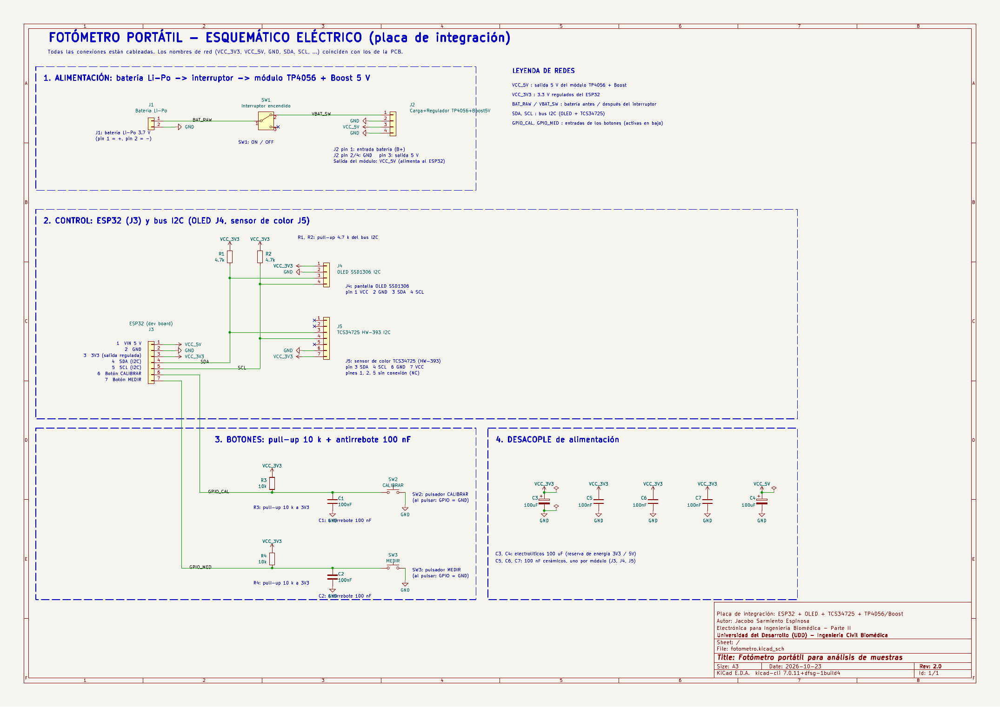
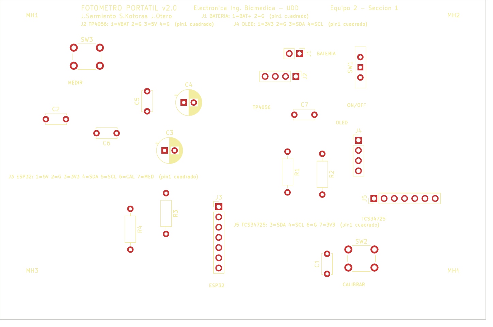
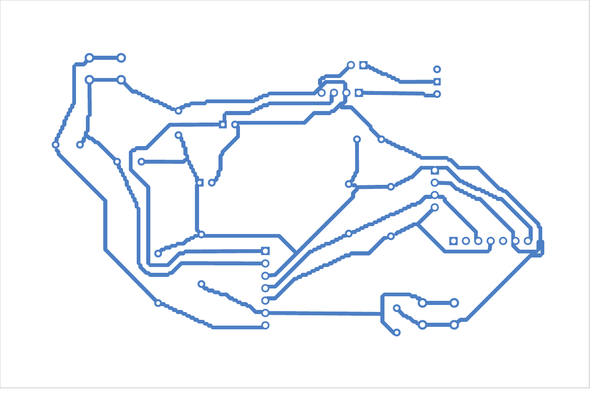
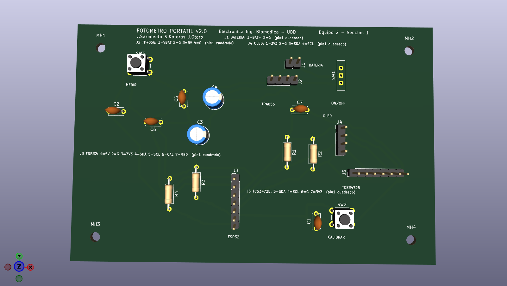
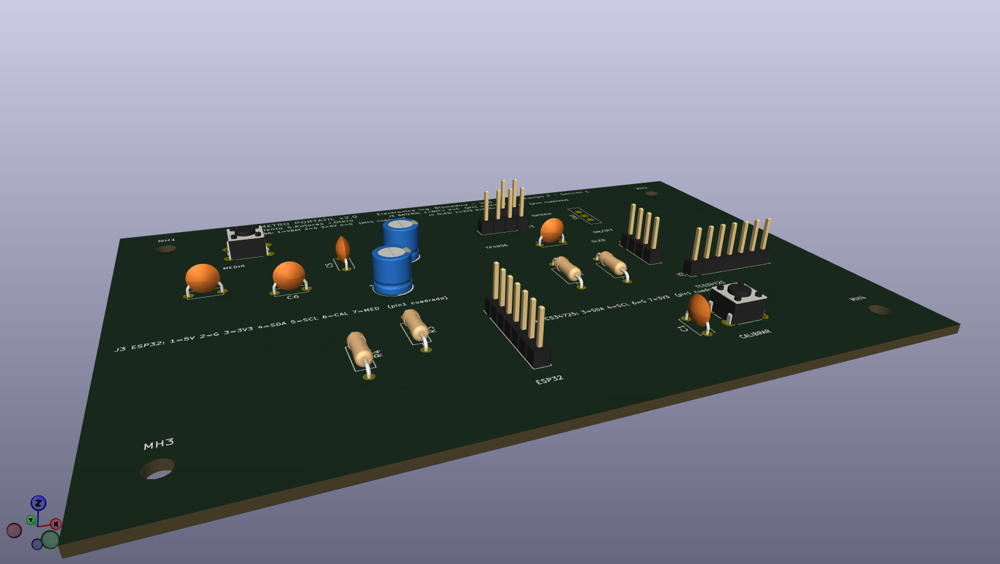
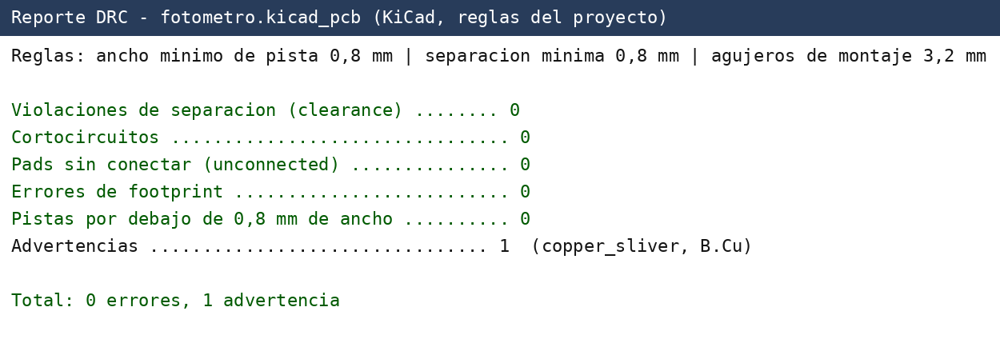

# Informe Parte II — Fotómetro portátil para análisis de muestras

## 1. Identificación del proyecto

| Campo | Detalle |
|---|---|
| **Proyecto** | Fotómetro portátil para análisis de muestras |
| **Curso y sección** | Electrónica para Ingeniería Biomédica (UDD), sección 1 |
| **Grupo / equipo** | Equipo 2 |
| **Integrantes** | Jacobo Sarmiento Espinosa (j.sarmientoe@udd.cl) · Sofía Kotoras (s.kotorasl@udd.cl) · Jimena Otero (j.oteroj@udd.cl) |
| **Fecha de entrega** | 30 de octubre de 2026 |
| **Repositorio** | <https://github.com/jacobosarmiento0505-sketch/Fot-metro-Port-til-Jacobo-Sarmiento> |

Fotómetro portátil de bajo costo, basado en un sensor de color digital I2C
(TCS34725) y un microcontrolador ESP32, con lectura de resultados en
pantalla OLED. El objetivo del equipo es estimar la concentración/color de
una muestra líquida a partir de la luz que transmite o refleja.

## 2. Actualización de la propuesta — cambio de sensor

En la Parte I se propuso un front-end analógico compuesto por un fotodiodo
**BPW34** y un amplificador operacional **LM324** para convertir la
fotocorriente en una señal de voltaje legible por el ADC del ESP32.

Durante la reunión de seguimiento con los profesores del curso, se sugirió
reemplazar ese front-end analógico por un **sensor de color digital I2C
TCS34725** (en su versión de módulo breakout **HW-393**), con el objetivo
de **simplificar el diseño electrónico y el firmware** del equipo:

- Se elimina la necesidad de diseñar y calibrar una etapa de amplificación
  analógica (ganancia, offset, filtrado de ruido).
- El sensor entrega directamente valores digitales de intensidad en los
  canales R, G, B y Clear por bus I2C, con control de ganancia e integración
  programable por software.
- Se reduce el conteo de componentes discretos (se eliminan el fotodiodo,
  el amplificador operacional y la resistencia de transimpedancia/red de
  compensación asociada).
- El sensor comparte el mismo bus I2C que ya se usaba para la pantalla
  OLED, por lo que no se agregan líneas de control adicionales al ESP32
  (solo SDA/SCL, ya presentes en el diseño).

Esta decisión se adoptó tal como fue sugerida por los profesores, delegando
en el diseño del asistente de IA los dos detalles de implementación no
especificados explícitamente por ellos:

- **Alimentación del sensor:** el módulo HW-393 acepta 3.3V–5V; se optó por
  alimentarlo desde el riel de **3.3V** (el mismo que usa el ESP32 y el
  OLED), para mantener un único nivel lógico en todo el bus I2C y evitar
  necesitar un conversor de nivel.
- **Pin de interrupción (INT) del sensor:** no se utiliza. El firmware
  puede leer el sensor por *polling* (lectura bajo demanda al presionar el
  botón MEDIR), que es suficiente para esta aplicación y simplifica tanto
  el hardware (un pin menos conectado) como el firmware (no requiere manejo
  de interrupciones).

El resto de la arquitectura (alimentación por batería Li-Po, carga/boost
vía TP4056, ESP32 como controlador, pantalla OLED I2C, botones de
calibración y medición) se mantiene igual a lo presentado en la Parte I.

## 3. Componentes, interfaces y BOM

El diseño sigue el criterio de **PCB de integración**: cada módulo
comercial (placa ESP32, display OLED, módulo cargador/boost, sensor
TCS34725) se representa en el esquemático como un **conector genérico tipo
header**, ya que estos módulos no se rediseñan a nivel de componente sino
que se integran mediante sus pines de interfaz. Esto está explícitamente
permitido por el Anexo 2 del enunciado.

La lista de materiales completa está en
[`electronica/outputs/BOM_fotometro.csv`](../../electronica/outputs/BOM_fotometro.csv).
Resumen de interfaces:

**Tabla 1.** Componentes, módulos e interfaces (corrientes estimadas a partir de las hojas de datos; ver `docs/datasheets/README.md`).

| Componente o módulo | Función | Alimentación / corriente estimada | Interfaz y señales | Conexión, origen y destino |
|---|---|---|---|---|
| Batería Li-Po (J1) | Fuente de energía | 3,7 V nominal | BAT_RAW, GND | Hacia SW1 y TP4056 |
| Interruptor SPDT (SW1) | Encendido general | Corriente total del equipo (< 1 A) | BAT_RAW → VBAT_SW | Entre J1 y J2 |
| Módulo TP4056 + boost 5 V (J2) | Carga de la batería y riel de 5 V | Entrada 3,7 V; salida 5 V, hasta ~1 A | VBAT_SW, GND, VCC_5V | Origen: SW1; destino: ESP32 (J3) |
| ESP32 dev board (J3) | Microcontrolador y regulador a 3,3 V | 5 V; ~80–240 mA | VCC_5V, GND, VCC_3V3, SDA, SCL, GPIO_CAL, GPIO_MED | Maestro I2C; entradas de los botones |
| OLED SSD1306 128x64 (J4) | Mostrar resultados | 3,3 V; ~20 mA | I²C: SDA y SCL | SDA/SCL hacia el ESP32 |
| Sensor de color TCS34725, módulo HW-393 (J5) | Medición de color/absorbancia | 3,3 V; ~0,3 mA + LED del módulo (~20 mA) | I²C: SDA y SCL (3 = SDA, 4 = SCL) | SDA/SCL hacia el ESP32 |
| Pulsador CALIBRAR (SW2) | Calibración con blanco | 3,3 V (pull-up 10 kΩ) | GPIO_CAL, antirrebote 100 nF | Hacia el ESP32 |
| Pulsador MEDIR (SW3) | Disparar la medición | 3,3 V (pull-up 10 kΩ) | GPIO_MED, antirrebote 100 nF | Hacia el ESP32 |
| R1, R2 (4,7 kΩ) | Pull-up del bus I2C | 3,3 V | SDA, SCL | Entre el riel de 3,3 V y el bus |
| C3, C4 (100 µF) y C5–C7 (100 nF) | Desacople de los rieles | — | VCC_3V3, VCC_5V | Junto a cada módulo |

## 4. Esquemático comentado

Archivo: `electronica/kicad/fotometro.kicad_sch`
(exportado también a [`electronica/outputs/fotometro_sch-1.png`](../../electronica/outputs/fotometro_sch-1.png)
y `fotometro_pcb.pdf`... ver `fotometro_sch.pdf` en `electronica/kicad/`).

Bloques del esquemático:

1. **Alimentación** (J1, SW1, J2): batería → interruptor → módulo
   cargador/boost, que entrega 5V regulados.
2. **Controlador y periféricos I2C** (J3, J4, J5): ESP32 alimentado a 5V
   (regula internamente a 3.3V), compartiendo el bus I2C con el OLED y el
   sensor de color. R1/R2 (4.7kΩ) son las resistencias de pull-up del bus.
3. **Entradas de usuario** (SW2, SW3 + R3/R4 + C1/C2): botones de
   calibración y medición, cada uno con pull-up de 10kΩ y capacitor de
   100nF para antirrebote por hardware.
4. **Desacople**: C3/C4 (100µF) como capacitores de bulto en los rieles de
   3.3V y 5V; C5/C6/C7 (100nF) como desacople local junto a cada módulo
   que consume del riel de 3.3V.

**Versión 2 del esquemático (según retroalimentación del profesor):** todos los
componentes están conectados con cables reales (ya no solo con etiquetas en
los pines); se agregaron títulos de bloque y textos descriptivos junto a cada
componente y a cada pin de los conectores; los botones SW2/SW3 se cablearon
como en el ejemplo del profesor (pull-up de 10 kΩ a 3V3, nodo con unión en la
línea del GPIO, pulsador a GND y capacitor de 100 nF a GND); y el ESP32 (J3)
tiene todos sus pines conectados (alimentación con símbolos de potencia, SDA/SCL
como buses hacia J4, J5 y los pull-ups, y los GPIO hacia los botones). Se
agregaron además PWR_FLAG en los rieles de alimentación.

Conectividad verificada automáticamente exportando el netlist
(`kicad-cli sch export netlist`) y comprobando que las 9 redes del circuito
(GND, VCC_3V3, VCC_5V, SDA, SCL, GPIO_CAL, GPIO_MED, BAT_RAW, VBAT_SW)
conectan los pines correctos, y que los pines no usados de los módulos
(p. ej. LED/INT del sensor, posición C del interruptor) quedan marcados
explícitamente como no conectados.

## 5. Librerías, footprints y modelos 3D

Todas las bibliotecas necesarias están **dentro del repositorio**
(`electronica/libraries/`) y se enlazan con rutas relativas (`${KIPRJMOD}`)
desde `electronica/kicad/sym-lib-table` y `fp-lib-table`, de modo que el
proyecto abre igual en otro computador.

1. **Símbolos** (`fotometro_custom.kicad_sym`): `SW_SPDT_COM1` (derivado de
   `Switch:SW_SPDT`, con los pines 1 y 2 intercambiados para que el pin 1 sea el
   común, igual que el pad 1 de la huella Würth), `VCC_3V3` y `VCC_5V`
   (derivados de `power:VCC`, para tener rieles separados). El resto de los
   símbolos son estándar de KiCad: `Device:R`, `Device:C`, `Device:C_Polarized`,
   `Connector_Generic:Conn_01x02/04/07`, `Switch:SW_Push`, `power:GND`.
2. **Footprints** (`*.pretty`): copias locales sin modificar de las huellas
   oficiales de KiCad usadas (headers de 2,54 mm de 2, 4 y 7 pines, interruptor
   `SW_Slide-03_Wuerth-WS-SLTV_10x2.5x6.4_P2.54mm`, pulsador `SW_PUSH_6mm`,
   resistencia axial, capacitor de disco, capacitor electrolítico radial y
   agujero de montaje `MountingHole_3.2mm_M3`).
3. **Modelos 3D**: `electronica/outputs/fotometro.step` (placa y componentes con
   modelo en las bibliotecas oficiales) y la vista 3D de la sección 6.
4. **Fuentes**: bibliotecas oficiales de KiCad
   (<https://gitlab.com/kicad/libraries/kicad-footprints>) y hojas de datos en
   `docs/datasheets/README.md`.

Verificación de los elementos personalizados: cantidad y numeración de pines
(3 en `SW_SPDT_COM1`, igual que la huella), correspondencia símbolo-huella, pin 1
(cuadrado en la serigrafía), separación de pines 2,54 mm, perforación de 1,0–1,1
mm en las huellas THT y 3,2 mm en los agujeros de montaje. Como los módulos
comerciales se integran por headers, no se rediseñan internamente.

## 6. Layout de PCB

Archivo: `electronica/kicad/fotometro.kicad_pcb`.

- Contorno cerrado en `Edge.Cuts`: **~121 x 80 mm**.
- **4 agujeros de montaje de 3,2 mm** cerca de las esquinas.
- Placa de **una sola cara**: las 277+ pistas están en **B.Cu** (0 en F.Cu),
  todas de **0,8 mm** de ancho y con separación mínima de **0,8 mm**.
- **Serigrafía** (F.SilkS): nombre del proyecto, versión de la placa (v2.0),
  curso, equipo, integrantes, referencia de cada componente, nombre de cada
  módulo, leyenda de pines de J1–J5 y pin 1 como pad cuadrado.
- Las **40 conexiones del esquemático están ruteadas** (0 pines sin conectar) y
  **0 cortocircuitos** (DRC y verificación geométrica de formas).

### 6.0 Verificación DRC

Se ejecutó el DRC con las reglas del enunciado (0,8 mm de ancho y separación)
sobre el archivo guardado: **0 errores y 0 violaciones de separación**. Queda
una sola advertencia, `copper_sliver` (B.Cu), un trozo de cobre estrecho en
la unión de pistas a 45° que no afecta la conectividad ni la fabricación en la
CNC; se deja documentada como advertencia intencional. Detalle en
`electronica/kicad/drc_report.txt`.

La versión anterior de la placa (aprobada en revisión, 117 x 77 mm) tenía 42
avisos de separación de 0,4 a 0,8 mm; se volvió a rutear con margen estricto de
0,8 mm entre redes distintas a costa de agrandar la placa un 3 %.

- El interruptor SW1 usa la huella `SW_Slide-03_Wuerth-WS-SLTV_10x2.5x6.4_P2.54mm`
  (pines a 2,54 mm) porque la anterior tenía pads a 2 mm entre sí, lo que
  impedía cumplir los 0,8 mm.

## 6.1 Retroalimentación del profesor y cambios realizados (versión 2)

Tras revisar la primera versión, el profesor pidió cuatro cambios, todos
aplicados y aprobados en la revisión posterior:

| # | Observación del profesor | Cambio realizado |
|---|---|---|
| 1 | Faltaban textos en el esquemático para reconocer los componentes de la placa | Títulos de bloque, descripción junto a cada componente y a cada pin de los conectores, y cuadro de título (hoja A3) |
| 2 | Los botones debían conectarse con cables, como en su ejemplo | SW2/SW3 cableados: pull-up de 10 kΩ a 3V3, unión en la línea del GPIO, pulsador a GND y capacitor de 100 nF a GND |
| 3 | El ESP32 (J3) estaba suelto, solo con etiquetas, lo que podía alterar el funcionamiento al implementar la placa | Todos los pines de J3 conectados con cables: alimentación con símbolos de potencia, buses SDA/SCL hacia J4, J5 y los pull-ups, y GPIO hacia los botones |
| 4 | La placa era muy grande y se perdía espacio | Placa rediseñada de ~175 x 220 mm a ~121 x 80 mm (cerca de la cuarta parte del área), con las 40 conexiones ruteadas y DRC sin violaciones de separación |

Verificación: el listado de conexiones (netlist) del esquemático coincide
exactamente con el de la PCB (0 diferencias), la placa tiene 0
cortocircuitos y 0 conexiones sin ruta.

## 7. Archivos de fabricación

Generados desde la misma versión final de la placa en `electronica/outputs/`:

- `gerbers/` — Gerbers de las capas usadas (F.Cu, B.Cu, máscaras, serigrafías,
  Edge.Cuts) + archivo de taladro (`fotometro.drl`)
- `fotometro_gerbers_y_taladro.zip` — Gerbers y perforaciones comprimidos
- `fotometro.step` — modelo 3D (STEP)
- `fotometro_pcb.pdf`, `.svg`, `fotometro_pcb_cara_superior.png`,
  `fotometro_pcb_cara_inferior.png`, `fotometro_vista3d_superior.png`, `fotometro_vista3d_perspectiva.png`, `fotometro_drc.png`
- `fotometro_sch.pdf` y `fotometro_sch-1.png` — esquemático
- `BOM_fotometro.csv` — lista de materiales

## 8. Repositorio

Estructura de carpetas según lo pedido por el enunciado (`README.md`,
`LICENSE`, `docs/`, `electronica/`, `firmware/`, `software/`). El proyecto
fue subido a un repositorio público de GitHub:
<https://github.com/jacobosarmiento0505-sketch/Fot-metro-Port-til-Jacobo-Sarmiento>

## 9. Uso de inteligencia artificial

Se utilizó un asistente de IA (Claude, Anthropic) para:

- Generar de forma programática el esquemático y el PCB en KiCad (vía las
  APIs `kiutils` y `pcbnew` de Python), a partir de la lista de materiales,
  la topología de conexiones y las restricciones de diseño definidas por el
  estudiante y el enunciado del curso.
- Adaptar el diseño al cambio de sensor sugerido por los profesores
  (TCS34725 en vez de fotodiodo + amplificador operacional), incluyendo dos
  decisiones de implementación (nivel de alimentación del sensor y uso del
  pin de interrupción) que fueron delegadas explícitamente al criterio del
  asistente.
- Aplicar la retroalimentación del profesor: rehacer el esquemático con
  cables y textos, y buscar una distribución de PCB compacta y enrutable en
  una sola capa mediante un algoritmo de optimización (recocido simulado) y
  un router de pistas propio.
- Redactar la documentación del repositorio (README, bitácora, este
  informe).

Todo el trabajo generado fue revisado por el estudiante antes de la entrega
final; el diseño del circuito (arquitectura, elección de componentes y
criterios de diseño) corresponde a decisiones tomadas por el estudiante y
los profesores del curso.

## 10. Conclusiones

**Decisiones de diseño.** El cambio a un sensor de color digital I2C
(TCS34725) simplificó el circuito, eliminó el front-end analógico y redujo el
riesgo de errores de diseño. La PCB es de integración: cada módulo comercial
se monta por headers de 2,54 mm. Se eligió un interruptor con pitch de 2,54 mm
para poder cumplir los 0,8 mm de separación.

**Componentes y módulos finales.** ESP32 (dev board), OLED SSD1306 I2C,
TCS34725 (HW-393), módulo TP4056 + boost 5 V, batería Li-Po, interruptor SPDT,
dos pulsadores con pull-up de 10 kΩ y capacitor antirrebote de 100 nF, pull-ups
I2C de 4,7 kΩ y capacitores de desacople (BOM completa en el repositorio).

**Estado del esquemático y del layout.** Esquemático completo, cableado,
con textos y pines no usados marcados como no conectados; su netlist coincide con
el de la PCB. La placa mide ~121 x 80 mm, con 4 agujeros M3 de 3,2 mm y serigrafía
de identificación.

**Cumplimiento del ruteo por B.Cu.** 100 %: las 40 conexiones están en B.Cu,
con pistas de 0,8 mm y separación de 0,8 mm, 0 puentes de alambre y 0 pistas en F.Cu.
DRC: 0 errores y 1 advertencia documentada (`copper_sliver`).

**Limitaciones y pendientes.** El STEP de KiCad solo incluye los modelos 3D que
existen en las bibliotecas. Los footprints genéricos de header no reproducen la
forma exacta de cada módulo comercial, y el firmware aún es un esqueleto. Antes
de fabricar conviene imprimir la huella a escala 1:1 y compararla con los módulos
reales (Anexo 3).

**Próxima etapa.** Fabricar la placa en la CNC del laboratorio, montar los
módulos, probar alimentación e I2C, escribir el firmware (lectura del
TCS34725, calibración con blanco, medición y despliegue en la OLED) y validar
con muestras.
